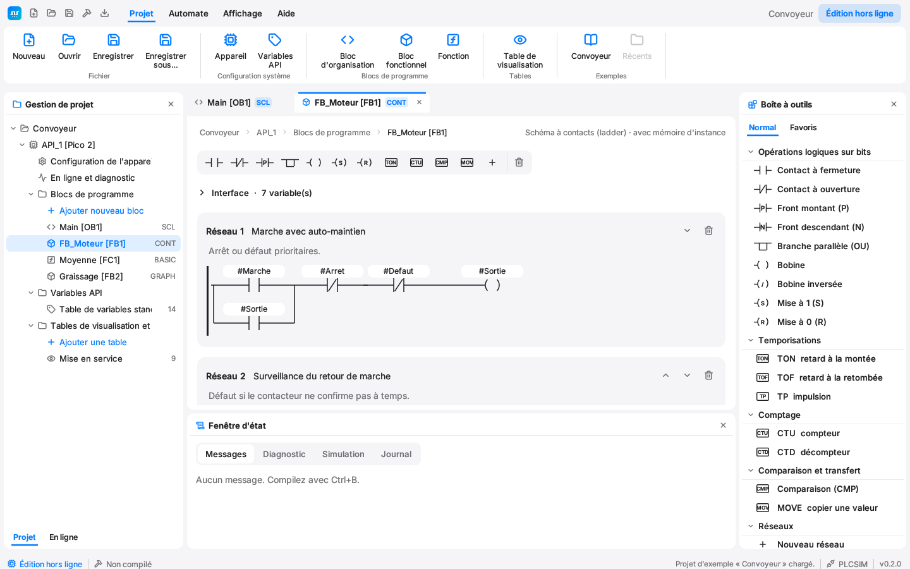
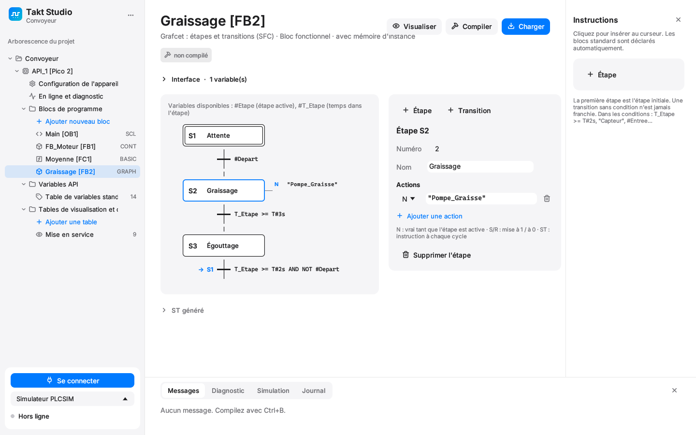

<p align="center"></p>

# Takt

**Un automate programmable à 5 €, avec un temps de cycle prouvé avant le téléchargement.**

Takt, c'est un IDE façon TIA Portal (Takt Studio) et un runtime pour le
Raspberry Pi RP2350 (Pico 2 et cartes compatibles, Waveshare…). Il est écrit
entièrement en Rust. On programme en Structured Text (IEC 61131-3, syntaxe SCL
de Siemens acceptée). Le compilateur **refuse tout programme dont il ne peut
pas prouver qu'il tient dans le temps de cycle**.

> **État :** prototype. Le compilateur, la VM, le simulateur et l'IDE sont
> testés sur PC. Le firmware RP2350 compile, mais **n'a encore jamais tourné
> sur une vraie carte**.

## Pourquoi « déterministe » ?

Un ESP32 ou un Arduino exécute le code depuis la flash, à travers un cache, au
milieu des interruptions Wi-Fi : le temps de cycle varie et personne ne sait
dire combien il vaut au pire. Takt attaque le problème à trois niveaux.

1. **Le langage.** Pas de `WHILE`/`REPEAT`, des `FOR` à bornes constantes,
   pas de récursion, pas d'allocation. Division par zéro et index hors bornes
   donnent un résultat défini (et un drapeau de diagnostic), jamais un plantage.
2. **Le compilateur.** Il calcule le **WCET** (temps d'exécution au pire cas)
   de chaque bloc à partir du coût de chaque instruction. Il ajoute la partie
   fixe du cycle (E/S, forçage, communication) et compare le total au temps de
   cycle configuré. Si ça ne tient pas, la compilation échoue avec un message
   clair. Le runtime fait respecter cette borne : un programme qui la
   dépasserait passe en défaut au lieu de déborder.
3. **Le matériel.** Sur le RP2350, le cœur 1 ne fait **que** l'automate. Son
   code est exécuté depuis la SRAM (pas de cache flash) et il est cadencé par
   un timer matériel en attente active. Le cœur 0 s'occupe de l'USB. Voir
   [firmware/takt-rp2350/README.md](firmware/takt-rp2350/README.md) pour le
   détail et les limites.

```
$ taktc examples/convoyeur.takt
info [Appareil] compilation réussie : 137 instructions, 48 mots mémoire, temps de cycle garanti 76 µs ≤ 1000 µs

WCET par bloc :
  Main                         3564 cycles      24 µs
  partie fixe du cycle         7800 cycles      52 µs
  total garanti : 76 µs / cycle 1000 µs (8 %)
```

## Takt Studio (l'IDE)



Les notions et les raccourcis de TIA Portal, dans une interface épurée façon
Apple (police Inter, icônes Lucide, thème clair et sombre) :

- **Arborescence du projet** comme dans TIA : appareil, blocs de programme
  numérotés (OB1, FB1, FC1…), variables API, tables de visualisation et de
  forçage, état de la liaison.
- **Quatre langages au choix pour chaque bloc** :
  - **CONT** (ladder) : réseaux avec titre et commentaire, contacts NO/NF/P/N,
    branches parallèles, TON/TOF/TP, CTU/CTD, comparateurs, MOVE, bobines
    `( )` `(/)` `(S)` `(R)`, barre des favoris ; en visualisation, le courant
    passe en vert ;
  - **SCL** (Structured Text) : éditeur texte avec coloration ;
  - **GRAPH** (SFC / grafcet) : étapes, actions N/S/R/ST, transitions et sauts,
    étape active en vert avec son temps ;
  - **BASIC** structuré : `IF/ELSEIF`, `FOR/NEXT`, `SELECT CASE`, `DIM`, `SET`/`RESET`.
- **Interface du bloc** (Input, Output, Static, Temp, Constant) pour CONT,
  GRAPH et BASIC, et **ST généré** affichable sous chaque bloc.
- **Configuration de l'appareil** : choix de la carte, schéma des broches,
  temps de cycle, jauge « temps de cycle garanti ».
- **Carte « Instructions »** adaptée au langage : palette CONT, étapes GRAPH,
  extraits SCL et BASIC ; les TON/CTU… insérés sont déclarés automatiquement
  (multi-instance).
- **Variables API** : `%I0.0`, `%Q0.1`, `%IW0`, `%QW2`, `%M`, ou sans adresse.
- **En ligne** : chargement, RUN/STOP, visualisation des valeurs dans le code
  (lunettes), tables de visualisation, modification et forçage, badge
  « programme identique / différent ».
- **Diagnostic** : WCET prouvé et temps mesuré (min/max), gigue, dépassements,
  histogramme.
- **PLCSIM intégré** : le simulateur exécute exactement le runtime du
  firmware, avec des interrupteurs pour les entrées et des voyants pour les sorties.




| Raccourci | Action |
|---|---|
| Ctrl+B | Compiler |
| Ctrl+L | Charger dans l'appareil |
| Ctrl+K / Ctrl+M | Liaison en ligne / hors ligne |
| Ctrl+T | Visualisation on/off |
| Ctrl+S | Enregistrer |

## Langages

CONT, GRAPH et BASIC sont traduits en Structured Text avant la compilation.
Les règles de déterminisme et la preuve du temps de cycle s'appliquent donc à
l'identique quel que soit le langage. Les erreurs sont renvoyées au réseau, à
l'étape ou à la ligne BASIC d'origine.

- GRAPH : la variable `Etape` contient l'étape active et `T_Etape` le temps
  passé dedans (`T_Etape >= T#2s` dans une condition).
- BASIC : `WHILE`, `DO … LOOP` et `GOTO` sont refusés comme en ST.

Le Structured Text accepté :

- Blocs : `ORGANIZATION_BLOCK` (ou `PROGRAM`), `FUNCTION_BLOCK`, `FUNCTION`.
- Types : `BOOL`, `INT` (16 bits), `DINT`, `REAL`, `TIME`, `ARRAY[a..b] OF …`.
- Instructions : `:=`, `IF/ELSIF/ELSE`, `CASE`, `FOR … BY`, `RETURN`.
- Blocs standard : `TON`, `TOF`, `TP`, `R_TRIG`, `F_TRIG`, `CTU`, `CTD`,
  `SR`, `RS`.
- Fonctions : `ABS`, `MIN`, `MAX`, `LIMIT`, `SEL`, `TRUNC`, `ROUND`,
  `NORM_X`, `SCALE_X`, conversions `X_TO_Y`.
- Syntaxe Siemens : `#local`, `"Variable API"`, `{ attributs }` ignorés.
- Variables système : `FirstScan`, `SysTime`.

Les FB et FC utilisateur sont développés en ligne à chaque appel, ce qui rend
le pire cas exact et interdit la récursion par construction.

## Organisation du dépôt

| Dossier | Contenu |
|---|---|
| `crates/takt-vm` | VM `no_std` : bytecode, blocs standard, runtime, protocole série. Partagée par le firmware et le simulateur. |
| `crates/takt-compiler` | Lexer, parser, analyse, génération du bytecode, calcul du WCET ; outil en ligne de commande `taktc`. |
| `crates/takt-ide` | Takt Studio (egui). |
| `firmware/takt-rp2350` | Firmware RP2350 (deux cœurs, exécution en SRAM). |
| `examples/` | Projet d'exemple : convoyeur avec un OB en SCL, le moteur en CONT, la moyenne en BASIC et le graissage en GRAPH. |
| `tools/logo.py` | Génère le logo (SVG, PNG, ICO). |

## Installer

Téléchargez `TaktStudio-<version>-setup.exe` dans les
[Releases](https://github.com/ideaton/takt/releases) et lancez-le. Aucun droit
administrateur n'est nécessaire : Takt Studio s'installe dans
`%LOCALAPPDATA%\Programs\Takt Studio`, avec un raccourci dans le menu Démarrer
et sur le bureau. Les fichiers `.takt` s'ouvrent par double-clic, et le projet
d'exemple est copié dans `Documents\Takt`. La désinstallation se fait depuis
« Applications installées » de Windows et garde vos projets.

Takt Studio vérifie au lancement s'il existe une version plus récente (option
dans « À propos »). « Installer et redémarrer » télécharge l'installateur,
vérifie son empreinte SHA-256 et met l'appli à jour.

### Publier une version

1. Augmenter `version` dans `Cargo.toml` et ajouter sa section dans `CHANGELOG.md`.
2. `git tag vX.Y.Z && git push origin vX.Y.Z`

Le workflow `Publication` lance les tests, construit l'installateur
(`tools/installeur.sh`, NSIS) et le publie avec son `.sha256`. Pour construire
l'installateur en local : `bash tools/installeur.sh`.

## Compiler et lancer

```bash
cargo run --release -p takt-ide --bin takt-studio
```

```bash
cargo run -p takt-compiler --bin taktc -- examples/convoyeur.takt
```

```bash
cargo test --workspace
```

Firmware (voir son README pour le flashage) :

```bash
cd firmware/takt-rp2350 && cargo build --release
```

## Limites connues

- Les coûts d'instruction (`crates/takt-vm/src/cost.rs`) sont des majorants
  **estimés**. Il faut les calibrer sur carte : le firmware mesure chaque cycle
  et l'IDE affiche le prouvé à côté du mesuré.
- Le programme téléchargé n'est pas encore sauvegardé en flash : il est perdu
  à la mise hors tension.
- Le firmware ne vérifie pas encore la table d'E/S reçue (broche inexistante
  ou utilisée deux fois).
- Pas encore de CONT/LOG (LD/FBD), de `VAR_IN_OUT`, de chaînes, ni de
  Modbus/Ethernet.
- L'identifiant USB est celui de test de pid.codes (1209:0001).

Captures d'écran de l'interface, rendues hors écran dans `target/captures` :

```bash
cargo test -p takt-ide captures -- --ignored
```

## Licence

GPL-3.0, voir [LICENSE](LICENSE). Police Inter (SIL OFL 1.1) et icônes Lucide
(ISC), voir `crates/takt-ide/assets/fonts`.
